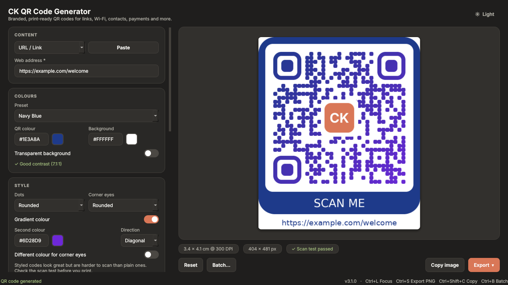

# CK QR Code Generator

Branded, print-ready QR codes for links, text, Wi-Fi, contacts, email, phone, SMS, WhatsApp, locations, calendar events and UPI payments. Add your logo, pick your colours and styles, add a "Scan me" frame, and export to PNG, JPG, SVG or PDF. Make hundreds at once from a spreadsheet. Everything runs offline on your PC.



## Download

<a href="https://apps.microsoft.com/detail/9NPSR6HWP1FF"></a>

Or install from a Windows terminal or PowerShell with winget:

```powershell
winget install 9NPSR6HWP1FF --source msstore
```

To update or remove it later:

```powershell
winget upgrade 9NPSR6HWP1FF --source msstore
winget uninstall 9NPSR6HWP1FF
```

Works on Windows 10 and Windows 11 (64-bit).

**Links:** [Feedback page](https://OWNER.github.io/REPO/) · [Report a problem](https://github.com/OWNER/REPO/issues/new?template=bug_report.yml) · [Privacy policy](PRIVACY.md)

## Highlights

- **11 QR code types:** link, text, Wi-Fi, contact card (vCard), email, phone, SMS, WhatsApp, location, calendar event and UPI payment
- **Batch generation** from an Excel or CSV file, one file per row
- **Your brand:** logo in the centre, 12 colour presets or custom colours, gradients, rounded or dotted styles, circular corner eyes, transparent background and "Scan me" frames
- **Built-in scan test:** every code is decoded after it's drawn, so you know it reads back correctly before you print it
- **Print-ready:** DPI from 72 to 1200, a size readout in centimetres, contrast and "too small to scan" warnings
- **Export** to PNG, JPG, SVG (vector) and PDF, or copy the image to the clipboard
- **Private:** works fully offline, with no accounts, tracking or network connections
- Dark and light themes, and drag and drop for links, logos and spreadsheets

## Contents

1. [Quick start](#quick-start)
2. [QR code types](#qr-code-types)
3. [Colours, styles and frames](#colours-styles-and-frames)
4. [Logo](#logo)
5. [Caption](#caption)
6. [Printing and exporting](#printing-and-exporting)
7. [Batch generation](#batch-generation)
8. [Keyboard shortcuts and drag and drop](#keyboard-shortcuts-and-drag-and-drop)
9. [Tips for codes that scan well](#tips-for-codes-that-scan-well)
10. [Troubleshooting](#troubleshooting)
11. [Feedback and support](#feedback-and-support)
12. [Privacy](#privacy)

## Quick start

1. Open the app. In the **Content** card, choose a type (the first drop-down) and fill in the details. Fields marked with * are required.
2. The preview on the right updates as you type. Below it you'll see the printed size, the image size in pixels and a **Scan test** result.
3. Optional: add a logo, change colours, pick a style or add a frame.
4. Click **Export** and choose PNG, JPEG, SVG or PDF, or click **Copy image** to paste it into another program.

## QR code types

Choose the type in the first drop-down of the **Content** card. **Paste** fills the main box from your clipboard.

| Type | Fill in | What scanning it does |
|---|---|---|
| **URL / Link** | Web address, for example `https://example.com` | Opens the address |
| **Text** | Any text, in any language | Shows the text |
| **Wi-Fi** | Network name, security (WPA/WPA2/WPA3, WEP or None), password, hidden network | Joins the network |
| **Contact (vCard)** | First or last name (required), organisation, title, mobile, work phone, email, website, address, note | Adds a contact |
| **Email** | To (required), subject, message | Starts an email |
| **Phone call** | Number | Dials the number |
| **SMS** | Number, optional message | Starts a text message |
| **WhatsApp** | Number with country code, optional message | Opens a WhatsApp chat |
| **Location** | Coordinates as `latitude, longitude` (for example `19.0760, 72.8777`), optional place name, link type | Opens a map |
| **Calendar event** | Title, start, end, location, description, all-day switch | Adds an event |
| **UPI payment** | UPI ID, payee name, optional amount in INR, optional note | Opens a payment to that UPI ID |

Notes on specific types:

- **Wi-Fi:** anyone who scans the code can join the network. The password is used only to draw the code and is never saved. Choose **None** for an open network.
- **Phone, SMS and WhatsApp:** include the country code, for example `+91 98765 43210`. Spaces and dashes are fine.
- **Location:** "Map link" works on all phones. "geo: link" is mainly for Android.
- **Calendar event:** with **All-day event** on, only the dates are used.
- **UPI payment:** the code pays whoever owns the UPI ID, so double-check it. The app asks you to confirm the payee, ID and amount before you export. It only builds the code and doesn't process payments. If you leave the amount empty, the payer chooses it.
- **Contact and calendar codes** hold a lot of data and make dense codes. Leave out fields you don't need so the code stays easy to scan.
- **Long content:** if there's too much data for one QR code, the app says so. Shorten the content.

If something is missing or wrong, the status bar at the bottom explains what to fix, and no code is drawn until it's right.

## Colours, styles and frames

**Colours card**
- Pick a **preset** or type your own hex colours (such as `#1E3A8A`) or use the colour picker.
- **Transparent background** is useful for posters and slides. It's shown as a checkerboard in the preview.
- The **contrast checker** warns when the colours are too close to scan. Dark on light works best.

**Style card**
- **Dots:** square, rounded or round.
- **Corner eyes:** the three large squares in the corners can be square, rounded or circular.
- **Gradient colour:** blends your QR colour into a second colour (diagonal, horizontal or vertical).
- **Different colour for corner eyes:** gives the corner squares their own colour.
- Styled codes look great but are harder to scan than plain ones. Keep an eye on the scan test.

**Frame card**
- Choose **Label below** or **Label above** and type a label such as `SCAN ME` or `JOIN WI-FI`. Pick the frame colour. The label text switches between black and white automatically so it stays readable.

## Logo

In the **Logo (optional)** card:
- **Upload** a PNG, JPG, GIF, BMP or WebP image, or drag one onto the window.
- **Clear** removes it.
- **Set default** remembers the current logo, and **Load default** brings it back later.
- **Logo size** goes from 10% to 30%. Use 20% or less for small prints. The logo sits on a white shield so the code stays readable. Large logos hide more of the code, so always check the scan test.

## Caption

In the **Caption** card:
- Turn **Show caption below QR** on or off.
- Leave **Caption text** empty for an automatic caption (for example the web address, the Wi-Fi name or the contact's name), or type your own.
- Choose a font, size and colour. **Word wrap** splits long captions over several lines instead of shrinking the text.

## Printing and exporting

**Print card**
- **Border (modules):** the blank margin around the code. The QR standard recommends 4. The default is 2, so raise it if the code will sit against a busy background.
- **DPI:** from 72 to 1200. Use 300 or higher for print. The size shown under the preview is the printed size in centimetres at that DPI. A warning appears if it's under 2 cm, which is too small to scan reliably.

**Export** (the button at the bottom right)
- **PNG** and **JPEG:** images at the chosen DPI. JPEG has no transparency, so transparent areas become white.
- **SVG:** a vector file that stays sharp at any size, with all your styles. Long captions are shortened to 60 characters in SVG files.
- **PDF:** a page sized exactly to the code, for print.

**Copy image** places the picture on your clipboard.

## Batch generation

Make many codes at once from a spreadsheet. Click **Batch...** (or press Ctrl+B), or drag an `.xlsx` or `.csv` file onto the window.

1. **Set up the look first.** In the main window, choose the **type** (for example Wi-Fi) and set the colours, style, frame, logo and caption settings you want for every code.
2. **Prepare your spreadsheet.** Put column names in the first row and one code per row below. Example for Wi-Fi:

   | ssid | password | name |
   |---|---|---|
   | Home | abc123 | home |
   | Guest | guest! | guest |

3. **Choose the file** with **Browse...**. Excel `.xlsx` (the first sheet is used) and `.csv` or `.tsv` files work. Columns whose names match the field names are matched for you.
4. **Match the columns.** For each field, pick the column to use. Fields you leave on "(use the value from the main window)" use whatever is in the main window, which is handy for something shared by every row. Optionally choose a **Caption** column and a **File name** column.
5. Choose the **format** (PNG, JPG, SVG or PDF) and an **output folder**, then click **Generate**. Click **Stop** to stop early.
6. When it finishes you'll see how many files were created. Click **Open folder** to see them.

**Column names that match automatically**

| Type | Column names |
|---|---|
| URL | `url` |
| Text | `text` |
| Wi-Fi | `ssid`, `security`, `password`, `hidden` |
| Contact | `first`, `last`, `org`, `title`, `mobile`, `phone2`, `email`, `website`, `street`, `city`, `state`, `zip`, `country`, `note` (labels such as "First name" or "Mobile" also match) |
| Email | `to`, `subject`, `body` |
| Phone | `number` |
| SMS and WhatsApp | `number`, `message` |
| Location | `coords`, `label` |
| Calendar event | `title`, `all_day`, `start`, `end`, `location`, `description` |
| UPI payment | `vpa`, `name`, `amount`, `note` |

You can always pick the column by hand if your names differ.

**Good to know**
- Rows with a problem (for example a missing Wi-Fi name) are skipped and listed so you can fix them. The other rows are still made.
- If two rows give the same file name, a number is added (`home.png`, `home_2.png`). With no file-name column, files are named `qr_0001`, `qr_0002` and so on.
- Dates in a spreadsheet can be real Excel dates or text like `2026-12-25 18:30`, `2026-12-25` or `25/12/2026 18:30`.
- Yes/no columns (such as `hidden` or `all_day`) accept `yes`, `true`, `1`, `y` or `x` for yes.
- For UPI batches, the app asks you to confirm first. Check every UPI ID in the sheet before printing or sharing.

## Keyboard shortcuts and drag and drop

| Shortcut | Action |
|---|---|
| Ctrl+L | Focus the first input box |
| Ctrl+S | Export as PNG |
| Ctrl+Shift+C | Copy image to clipboard |
| Ctrl+B | Open batch generation |

**Drag and drop onto the window**
- A **link or text** fills the URL or Text type.
- An **image** becomes the logo.
- An **`.xlsx` or `.csv` file** opens batch generation.

The **Reset** button clears everything back to the defaults. The **Light/Dark** button in the top right switches the theme and remembers your choice.

## Tips for codes that scan well

- Keep strong contrast between the QR colour and the background.
- Wait for the green **Scan test passed** tick before you export. It confirms the finished image reads back as exactly what you entered.
- Keep the logo at 20% or smaller for small prints.
- For print, use 300 DPI or higher and make the code at least 2 cm wide.
- Always test one printed code with a real phone before printing many, especially styled codes.
- Keep the quiet-zone border at 4 or more if the code sits on a busy background.

## Troubleshooting

| Problem | What to try |
|---|---|
| **Scan test failed** | Make the logo smaller, use the plain Square dots and eyes, raise the contrast, or shorten the content. |
| **Phone can't read a code that passed the scan test** | Make the code bigger when printing, raise the border, and avoid very light colours or glossy surfaces. |
| **"Too small to scan reliably"** | Increase the printed size or lower the DPI so the code is at least 2 cm wide. |
| **"Too much data for one QR code"** | Shorten the content. Contact and calendar codes with long notes can be too big. |
| **No code appears** | Read the message in the status bar at the bottom. A required field is probably empty or invalid. |
| **Excel file won't open in Batch** | Save the sheet as `.csv` and try again. |
| **Batch skipped some rows** | The list in the dialog says which rows and why. Fix them and run again. |
| **"Default logo not found"** | The saved file moved. Upload the logo again and click **Set default**. |
| **Wi-Fi code doesn't connect** | Check the exact network name and password (they are case-sensitive) and the security type. |
| **WhatsApp or SMS opens the wrong number** | Enter the full number with country code, for example `+91 98765 43210`. |

## Feedback and support

- **Share feedback, report a problem or suggest a feature:** use the [feedback page](https://OWNER.github.io/REPO/) or [open an issue](https://github.com/OWNER/REPO/issues/new/choose) and pick a form.
- **Questions and ideas:** [Discussions](https://github.com/OWNER/REPO/discussions).
- Enjoying the app? A rating on the [Microsoft Store](https://apps.microsoft.com/detail/9NPSR6HWP1FF) helps others find it.
- Please don't post Wi-Fi passwords, UPI IDs or personal phone numbers. Made-up sample values are fine.

## Privacy

Read the full [privacy policy](PRIVACY.md). In short: the app works entirely on your computer. It makes no network connections and collects, stores or sends no personal data. Everything you type, including Wi-Fi passwords, contact details and payment details, is used only to draw the code and is never saved. The app remembers only your theme and the file path of your default logo.
